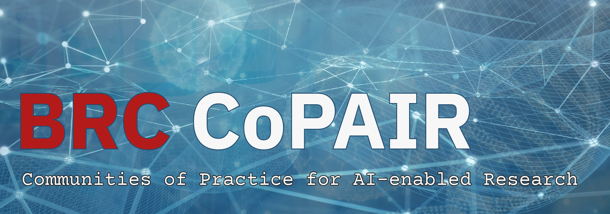

# CoPAIR

**Communities of Practice for AI-enabled Research**

CoPAIR is a pilot program run by the Biotechnology Resource Center (BRC) for exploring how artificial intelligence can help address real research problems in the life sciences. It brings together researchers, faculty advisors, and BioHPC staff to develop, test, and evaluate AI-enabled research workflows — and turn promising approaches into reusable skills that can be shared with the broader research community.

**[Visit the CoPAIR site →](https://cornell-biohpc.github.io/CoPAIR/)**
